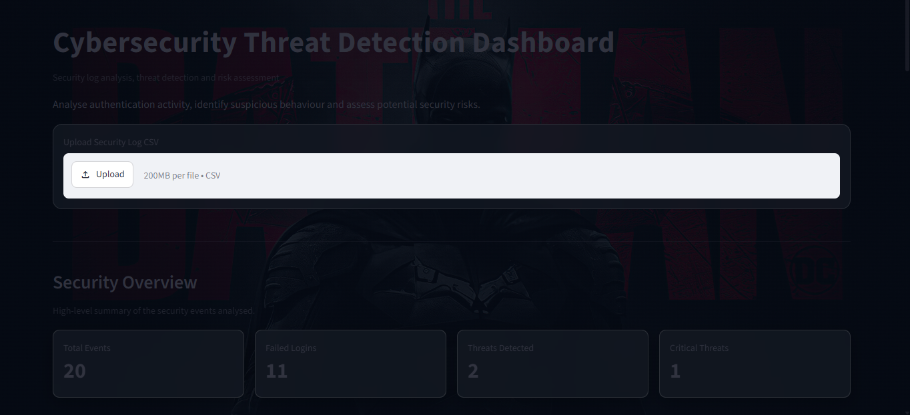
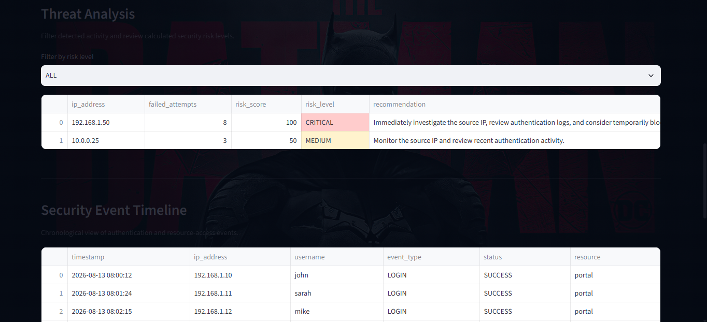
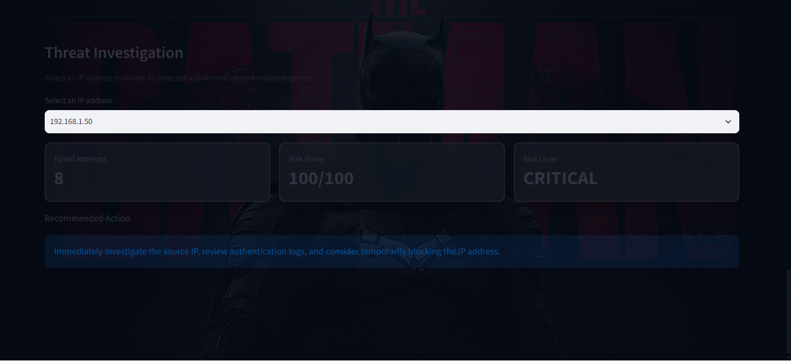

# Cybersecurity Threat Detection Dashboard

A Python and Streamlit-based cybersecurity dashboard for analysing security logs, identifying suspicious authentication activity, calculating risk levels, and supporting basic threat investigation.

## Overview

The Cybersecurity Threat Detection Dashboard analyses authentication and security events from CSV log files.

The application identifies suspicious login behaviour by analysing failed authentication attempts associated with source IP addresses. Detected activity is assigned a risk score and risk level, allowing users to quickly identify potentially high-risk activity.

The dashboard provides an interactive interface for analysing the results rather than requiring users to work directly with raw log files.

## Features

* Upload security log CSV files
* Analyse authentication activity
* Detect repeated failed login attempts
* Group failed login attempts by IP address
* Calculate security risk scores
* Classify detected activity into risk levels
* Filter threats by risk level
* Display security overview metrics
* Visualise failed login activity
* Visualise risk-level distribution
* View a chronological security event timeline
* Investigate individual IP addresses
* Display recommended security actions
* Provide a cybersecurity-focused dashboard interface

## Dashboard

The dashboard provides four high-level security metrics:

* Total Events
* Failed Logins
* Threats Detected
* Critical Threats

It also provides visual analysis of failed login activity and detected risk levels.

## Threat Investigation

Users can select a detected IP address to investigate its activity.

The investigation panel displays:

* Failed login attempts
* Risk score
* Risk level
* Recommended action

This allows the application to move beyond simply displaying raw security logs and provide a basic decision-support layer for security analysis.

## Technology Stack

* Python
* Streamlit
* Pandas
* Matplotlib
* Git
* GitHub

## Project Structure

```text
Cybersecurity-Log-Analyzer/
│
├── app.py
├── detector.py
├── requirements.txt
├── README.md
├── .gitignore
│
├── assets/
│   └── cyber-background.jpg
│
└── data/
    └── security_logs.csv
```

## How It Works

The application follows a simple security-analysis workflow:

```text
Security Log CSV
       |
       v
Log Processing
       |
       v
Failed Login Analysis
       |
       v
IP-Based Threat Detection
       |
       v
Risk Score Calculation
       |
       v
Risk Classification
       |
       v
Interactive Dashboard
       |
       v
Threat Investigation
```

## Running Locally

### 1. Clone the repository

```bash
git clone https://github.com/tumiiiey2323/Cybersecurity-Log-Analyzer.git
```

### 2. Navigate into the project

```bash
cd Cybersecurity-Log-Analyzer
```

### 3. Create a virtual environment

```bash
python -m venv venv
```

### 4. Activate the virtual environment on Windows

```bash
venv\Scripts\activate
```

### 5. Install dependencies

```bash
pip install -r requirements.txt
```

### 6. Run the dashboard

```bash
streamlit run app.py
```

The application will open in your browser.

## Example Analysis

The included sample dataset contains authentication and security events.

The application can identify repeated failed login attempts from individual IP addresses and assign corresponding risk levels.

For example, repeated failed authentication attempts from the same source IP can be flagged as potentially suspicious activity.

## Screenshots

### Dashboard Overview



### Threat Analysis



### Threat Investigation



## Responsible Use

This project is intended as an educational cybersecurity analytics and decision-support prototype.

It should not be treated as a production intrusion detection system or as a replacement for a security operations team.

Risk scores and classifications are based on the logic implemented in the prototype and should be validated against real-world security requirements before production use.

The project should only be used with security logs and systems that you are authorised to analyse.

## Limitations

The current prototype has several limitations:

* The sample dataset is small.
* Detection logic is based primarily on failed authentication activity.
* It does not analyse network packets.
* It does not perform endpoint detection.
* It does not integrate with a SIEM platform.
* Risk scores are rule-based rather than produced by a trained machine-learning model.
* Real-world environments would require larger datasets and additional detection techniques.

## Future Improvements

Potential improvements include:

* Real-time log ingestion
* Additional authentication and attack-pattern detection
* GeoIP analysis
* User-based anomaly detection
* Machine-learning-based anomaly detection
* SIEM integration
* Automated alerting
* Authentication heatmaps
* Advanced threat correlation
* Database-backed log storage
* Cloud deployment
* Security monitoring and model evaluation

## Author

Itumeleng Molefe

BSc Information Technology Graduate
North-West University

GitHub: https://github.com/tumiiiey2323

Portfolio: https://tumiiiey2323.github.io/Itumeleng-portfolio/
